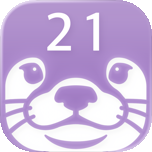

# 슈달력 · Ottercal

**수달이 함께하는 아이폰 캘린더.** 아이콘에는 오늘 날짜가, 일정 알림에는 수달 사진이 한 장씩 따라옵니다.
*An iPhone calendar with otters — today's date on the icon, and an otter photo with every reminder.*

## 할 수 있는 것
- **아이폰 캘린더 그대로** — 아이폰 캘린더·iCloud·구글(아이폰 계정 연동) 일정을 한 곳에서 봅니다.
- **퀵 메모로 일정 쓰기** — "내일 저녁 7시 강남역 저녁" 처럼 적으면 날짜·시각·장소를 알아서 채웁니다.
- **긴 일정 나누기·잇기** — 여러 날 일정을 잘라 단계별로 쓰고, 한 줄로 이어 봅니다.
- **기념일·디데이** — 지난 날부터 세기, 100일·주년 알림.
- **위젯** — 오늘 일정과 수달 사진을 홈 화면에.
- **구글 연결(선택)** — 구글 할 일을 함께 보고, 구글 캘린더 일정에 메일 알림을 겁니다. 연결은 언제든 끊을 수 있어요.

## 구글 데이터 사용 · Google data
구글 계정 연결은 선택입니다. 연결하면 슈달력은 구글 할 일을 보여 주고 고치며, 사용자가 요청할 때 구글 캘린더를 만들거나 지우고, 사용자가 켠 경우 구글 캘린더 일정에 메일 알림을 겁니다. 구글 데이터는 아이폰과 구글 사이에서만 오가며, 운영자가 받거나 다른 곳에 넘기지 않습니다. 자세한 내용은 [개인정보 처리방침](privacy.html)을 봐 주세요.
*Connecting a Google account is optional. Ottercal then shows and edits your Google Tasks, creates or deletes Google calendars when you ask, and sets email reminders on Google Calendar events if you turn that on. Your Google data travels only between your iPhone and Google; we never receive or share it. See the [Privacy Policy](privacy.en.html).*

## 둘러보기
- 🦦 [수달 사진 보기 · Otters](otters.html)
- [개인정보 처리방침](privacy.html) · [Privacy Policy](privacy.en.html)
- [지원 · Support](support.html)

문의 · Contact: ottercal.app@gmail.com

© 2026 binarybiscuit

